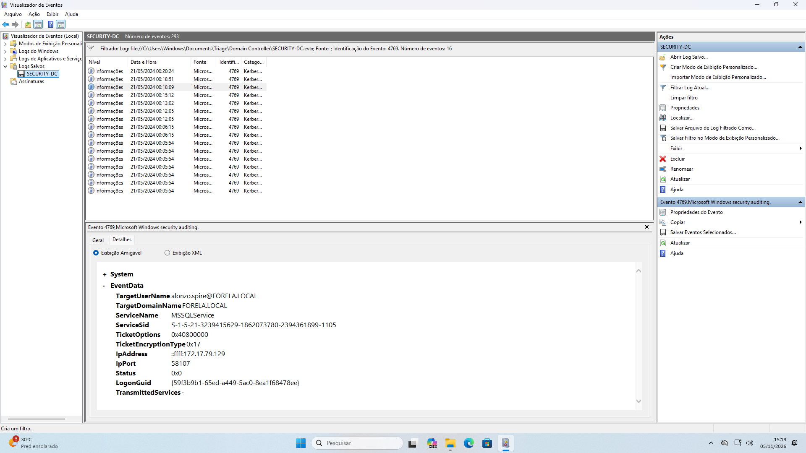
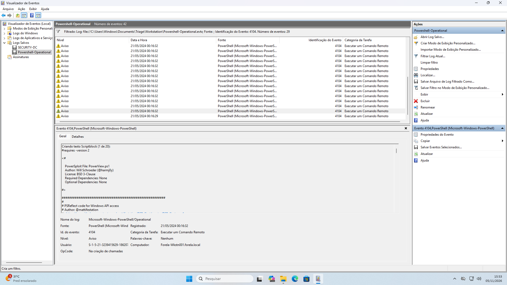
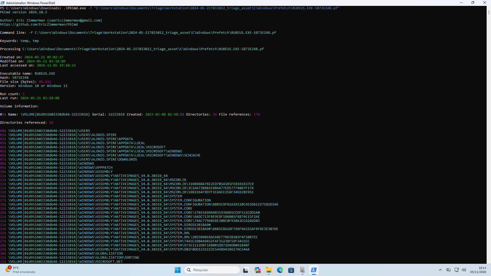

# Campfire-1

**Difficulty:** Very Easy

**Description:** Familiarization with Windows security logs, PowerShell Operational logs, and Prefetch artefacts for identifying and analyzing Kerberoasting activity in Active Directory environments. The lab focuses on detecting Kerberoasting attacks through Domain Controller and endpoint artefacts, correlating relevant events, and distinguishing malicious activity from legitimate behavior to avoid false positives.

### Investigation Summary

This investigation focused on identifying and analyzing a Kerberoasting attack within an Active Directory environment.

The investigation involved correlating Domain Controller Security Logs, PowerShell Operational Logs, and Windows Prefetch artefacts to identify the source workstation, the targeted service account, the enumeration script, and the tool used to perform the Kerberoasting attack.

By analyzing Event ID 4769, Event ID 4104, and Prefetch artefacts with PECmd.exe, I was able to reconstruct the sequence of activities and identify the tools and timestamps associated with the attack.

### Tools Used

- **Windows Event Viewer:** Used to filter and analyze Windows Security and PowerShell Operational logs.
- **PowerShell Operational Logs:** Used to identify executed scripts and investigate suspicious PowerShell activity.
- **PECmd.exe:** Eric Zimmerman's tool used to analyze Prefetch artefacts and identify program execution history.
- **Windows Prefetch:** Used to identify executed applications, execution timestamps, and referenced file paths.

### 1 - Analyzing Domain Controller Security Logs, can you confirm the UTC date & time when the kerberoasting activity occurred?

For this question, I had to use the hint:

- In the Security Logs, filter for Event ID 4769.

After filtering, I noticed that only one event involved the MSSQLService. The TicketEncryptionType was set to RC4 (0x17), and the event contained an IP address identifying the source of the service ticket request.



The timestamp is 21/05/2024 00:18:09, but since the question asks for UTC, I had to add 3 hours to convert it.

**Answer:**

```text
2024-05-21 03:18:09
```

### 2 - What is the Service Name that was targeted?

Using the same event log, we can see that the requested service is MSSQLService.


**Answer:**

```text
MSSQLService
```

### 3 - It is really important to identify the Workstation from which this activity occurred. What is the IP Address of the workstation?

Again, we can use the same event to answer the third question. The source IP address is listed in the `IpAddress` field.


**Answer:**

```text
172.17.79.129
```

### 4 - Now that we have identified the workstation, a triage including PowerShell logs and Prefetch files are provided to you for some deeper insights so we can understand how this activity occurred on the endpoint. What is the name of the file used to Enumerate Active directory objects and possibly find Kerberoastable accounts in the network?

I analyzed the PowerShell logs and filtered for Event ID 4104 to identify executed commands. I found references to `PowerView.ps1`.

- **PowerView.ps1:** A PowerShell-based tool from the PowerSploit framework used for Active Directory enumeration, allowing users to discover domain information, users, groups, computers, and service accounts (SPNs). It is commonly used during reconnaissance and Kerberoasting attacks.



**Answer:**

```text
powerview.ps1
```

### 5 - When was this script executed? (UTC)

Using the same event log, we can see that the script was executed on 21/05/2024 at 00:16:32.


The question asks for the timestamp in UTC, so I added 3 hours.

**Answer:**

```text
2024-05-21 03:16:32
```

### 6 - What is the full path of the tool used to perform the actual kerberoasting attack?

For this question, I downloaded PECmd.exe from Eric Zimmerman's Tools and used it to analyze the Rubeus Prefetch file. Rubeus is a tool commonly used in Kerberoasting attacks.



It shows the program's execution history, including its last execution timestamp and referenced file paths.

**Answer:**

```text
C:\Users\Alonzo.spire\Downloads\Rubeus.exe
```

### 7 - When was the tool executed to dump credentials? (UTC)

I can use PECmd.exe from the previous question to check the timestamp.


It shows `Run count: 1` and `Last run: 2024-05-21 03:18:08`.

This timestamp is already in UTC.

**Answer:**

```text
2024-05-21 03:18:08
```

### Key Takeaways

- **Windows Event IDs:** Understanding Event IDs is essential for identifying relevant events and knowing what to look for during log analysis. They help narrow down the investigation and make it easier to find suspicious activity.
- **PowerShell Log Analysis:** Learned how to analyze PowerShell logs to identify script execution attempts and investigate potentially malicious activity.
- **Prefetch Analysis:** Learned how to use PECmd.exe to analyze Prefetch files, identify program execution, check execution timestamps, and find referenced file paths.
- **Active Directory Enumeration:** Learned how tools such as PowerView can be used to enumerate Active Directory environments and identify potentially Kerberoastable accounts.
- **Kerberoasting Detection:** Learned how to correlate Domain Controller Security Logs and endpoint artefacts to investigate Kerberoasting activity.
