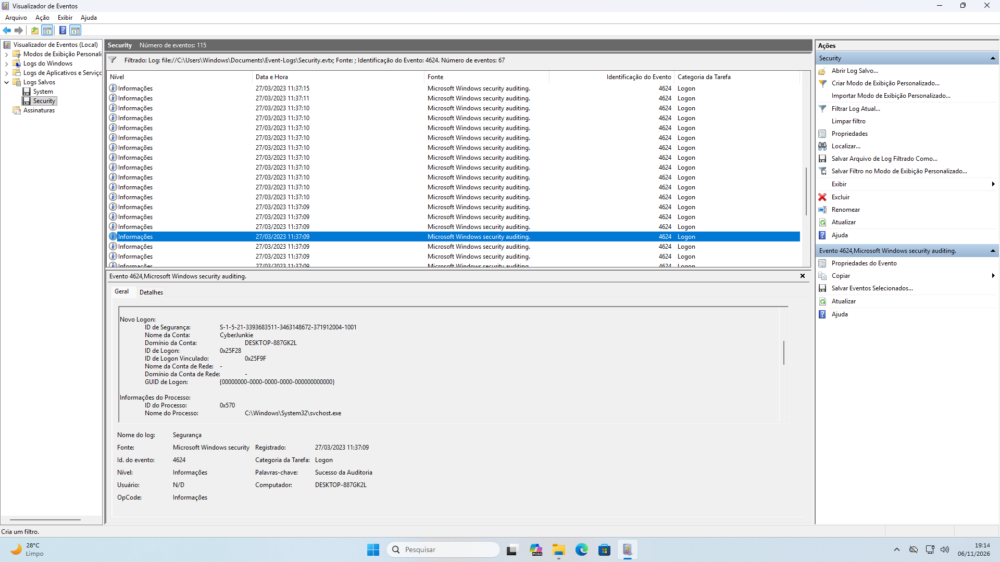
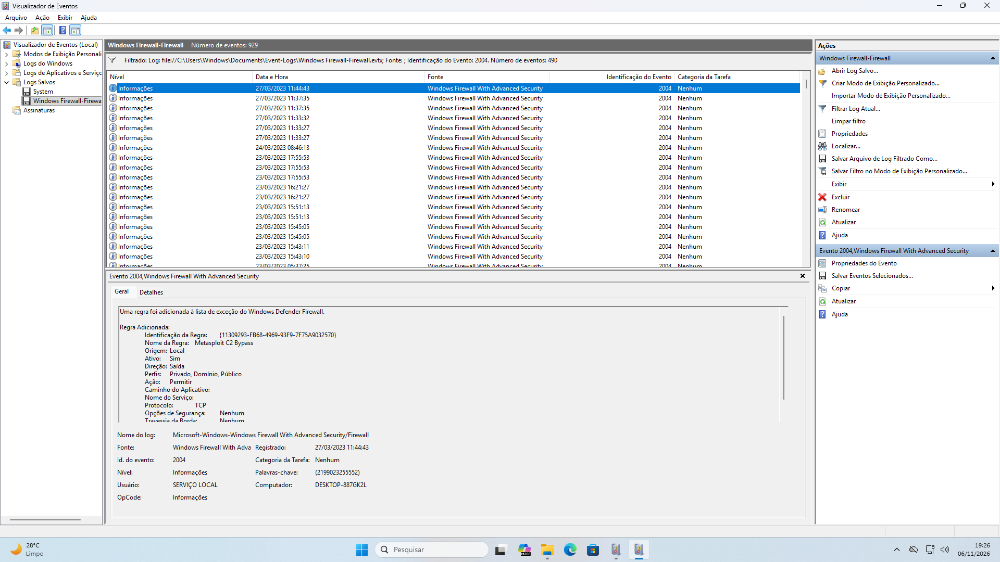
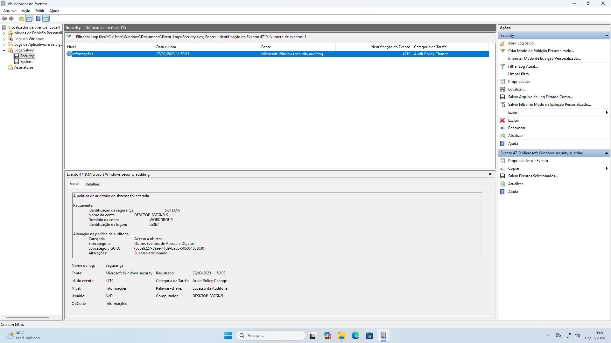
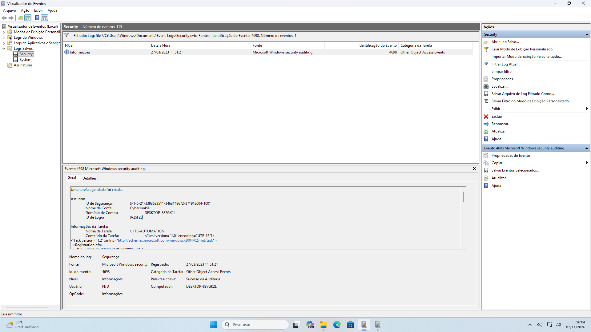
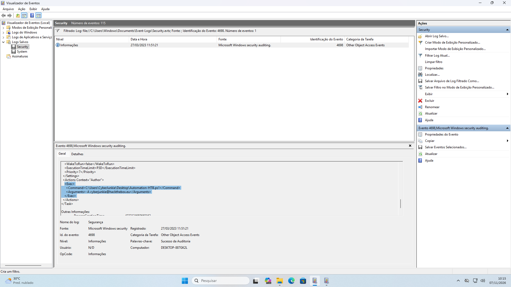
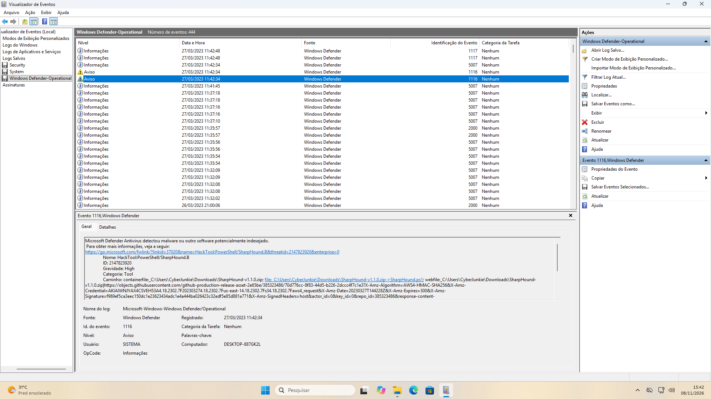
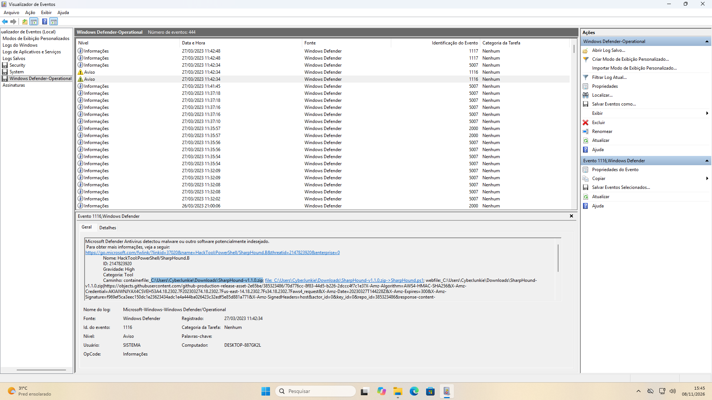
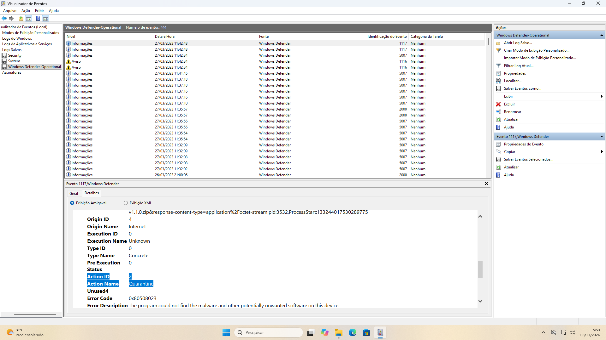
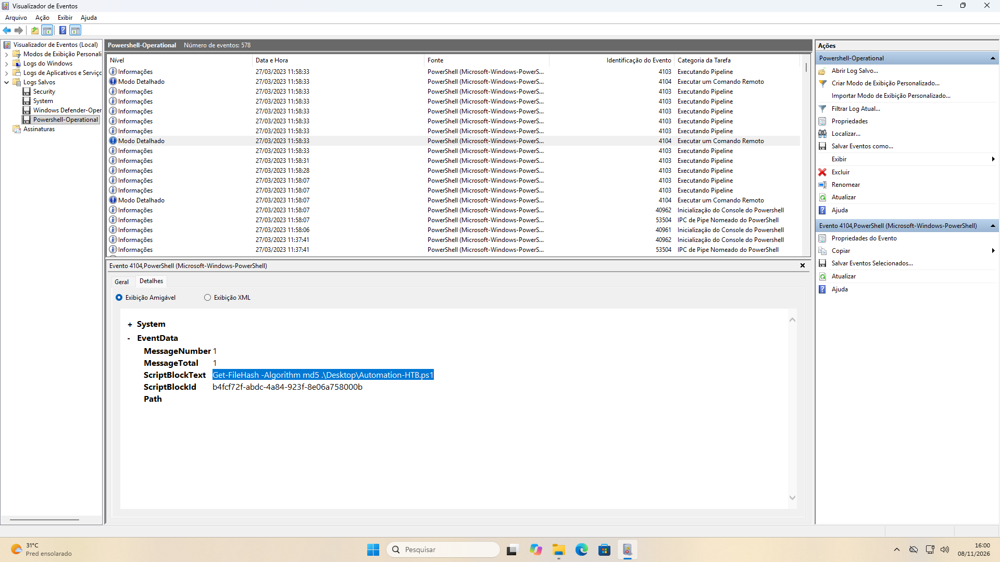
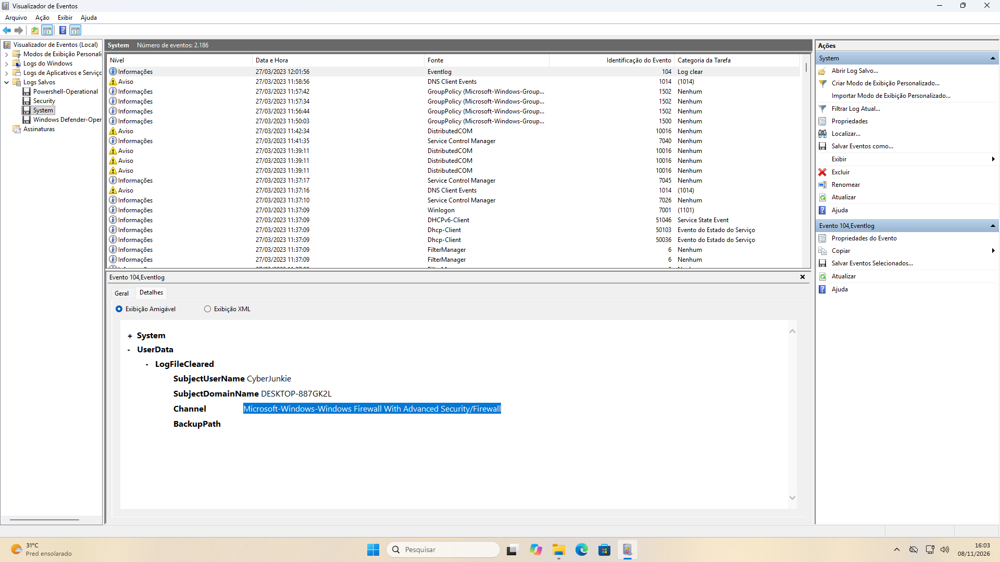

# LogJammer

**Difficulty:** Easy

**Description:** An entry-level Digital Forensics and Incident Response (DFIR) challenge focused on Windows Event Log Analysis. The challenge involves examining and interpreting Windows Event Logs, identifying relevant Event IDs, recognizing noteworthy security events, and reporting findings based on the available evidence. It simulates a real-world DFIR assessment, testing the ability to investigate and analyze Windows event logs.

### Investigation Summary

This investigation focused on analyzing Windows Event Logs to identify suspicious activities performed by a user named cyberjunkie.

The investigation involved examining Security, System, Windows Defender Operational, and PowerShell logs to reconstruct the sequence of events and identify potential malicious activities.

By analyzing relevant Event IDs, I identified successful logons, unauthorized firewall rule modifications, audit policy changes, scheduled task creation, antivirus detections, PowerShell command execution, and the clearing of an event log.

The collected evidence helped establish the activities performed on the system and identify potential indicators of compromise.

### Tools Used

- **Windows Event Viewer:** Used to filter, examine, and investigate Windows Event Logs.
- **Windows Security Logs:** Used to investigate successful logons, audit policy changes, and scheduled task creation.
- **Windows Defender Operational Logs:** Used to identify malware detections, affected files, and antivirus actions.
- **PowerShell Operational Logs:** Used to investigate PowerShell command execution.
- **Windows System Logs:** Used to identify event log clearing activities.
- **EVTX Files:** Analyzed to investigate system activity and correlate relevant security events.

### 1 - When did the cyberjunkie user first successfully log into his computer? (UTC)

I started by filtering the events using Event ID 4624, which represents a successful logon.

This reduced the number of events from 115 to 67.

After analyzing the events one by one, I found a logon event for the user cyberjunk on 27/03/2023 at 11:52:43.



Since the question asks for a UTC timestamp, I added 3 hours to the original timestamp.

**Answer:**

```text
27/03/2023 14:37:09
```

### 2 - The user tampered with firewall settings on the system. Analyze the firewall event logs to find out the Name of the firewall rule added?

For this question, I filtered the events using Event ID 2004, which indicates that a firewall rule was added.

The last event shows that a rule named "Metasploit C2 Bypass" was added to the Windows Defender Firewall exception list.

After researching this technique, I found that it can be used to allow Metasploit C2 communication through the firewall by creating an exception for outbound traffic.



**Answer:**

```text
Metasploit C2 Bypass
```

### 3 - Whats the direction of the firewall rule?

This question can be answered using the information from the previous question.

The event log shows that the direction is Outbound.


**Answer:**

```text
Outbound
```

### 4 - The user changed audit policy of the computer. Whats the Subcategory of this changed policy?

I found that Event ID 4719 corresponds to an audit policy change.

I then checked all the provided EVTX files, and the Security log contained one event with that ID.



The event shows that the subcategory is "Other Object Access Events"

**Answer:**

```text
Other Object Access Events
```

### 5 - The user "cyberjunkie" created a scheduled task. Whats the name of this task?

For this question, I filtered the events using Event ID 4698, which indicates that a scheduled task was created.

The Security log contained one event with that ID.



The event shows that the task name is HTB-AUTOMATION

**Answer:**

```text
HTB-AUTOMATION
```

### 6 - Whats the full path of the file which was scheduled for the task?

Using the same event, I analyzed its details further.

There is an `<Exec>` tag that shows the full path of the scheduled file.



It shows that the command used was `C:\Users\CyberJunkie\Desktop\Automation-HTB.ps1`.

**Answer:**

```text
C:\Users\CyberJunkie\Desktop\Automation-HTB.ps1
```

### 7 - What are the arguments of the command?

This information can be found in the same event and screenshot from the previous question.

Above the command, it shows that an argument was used: `-A cyberjunkie@hackthebox.eu`.


**Answer:**

```text
-A cyberjunkie@hackthebox.eu
```

### 8 - The antivirus running on the system identified a threat and performed actions on it. Which tool was identified as malware by antivirus?

For this question, I analyzed the Windows Defender Operational EVTX log.

I found that the antivirus detected a potential malware named SharpHound.



**Answer:**

```text
SharpHound
```

### 9 - Whats the full path of the malware which raised the alert?

This question can be answered by analyzing the same log from the previous question.

The full path shows: `C:\Users\CyberJunkie\Downloads\SharpHound-v1.1.0.zip`.



**Answer:**

```text
C:\Users\CyberJunkie\Downloads\SharpHound-v1.1.0.zip
```

### 10 - What action was taken by the antivirus?

I analyzed the event log and found that the antivirus quarantined the file.



**Answer:**

```text
Quarantine
```

### 11 - The user used Powershell to execute commands. What command was executed by the user?

I analyzed the PowerShell EVTX log and found an event with Event ID 4104, which records executed commands.

After analyzing the event, I found the following command: `Get-FileHash -Algorithm md5 .\Desktop\Automation-HTB.ps1`.



**Answer:**

```text
Get-FileHash -Algorithm md5 .\Desktop\Automation-HTB.ps1
```

### 12 - We suspect the user deleted some event logs. Which Event log file was cleared?

For this question, I analyzed the System log for Event ID 104.

I found that the user cleared the `Microsoft-Windows-Windows Firewall With Advanced Security/Firewall` log.



**Answer:**

```text
Microsoft-Windows-Windows Firewall With Advanced Security/Firewall
```

### Key Takeaways

- **Windows Event Log Analysis:** Learned how to investigate different Windows Event Logs and identify relevant Event IDs to detect suspicious activities.
- **Logon Analysis:** Learned how to use Event ID 4624 to investigate successful logon events and identify user activity.
- **Firewall Rule Investigation:** Learned how to identify unauthorized firewall rule modifications, analyze rule names, and determine traffic direction.
- **Audit Policy Monitoring:** Learned how to identify changes to Windows audit policies using Event ID 4719.
- **Scheduled Task Investigation:** Learned how to investigate scheduled task creation using Event ID 4698 and identify associated commands, file paths, and arguments.
- **Antivirus Detection Analysis:** Learned how to investigate Windows Defender alerts, identify detected threats, locate affected files, and determine the actions taken by the antivirus.
- **PowerShell Log Analysis:** Learned how to use Event ID 4104 to identify and investigate commands executed through PowerShell.
- **Event Log Clearing Detection:** Learned how to identify cleared Windows Event Logs using Event ID 104 and investigate potential attempts to remove security evidence.
