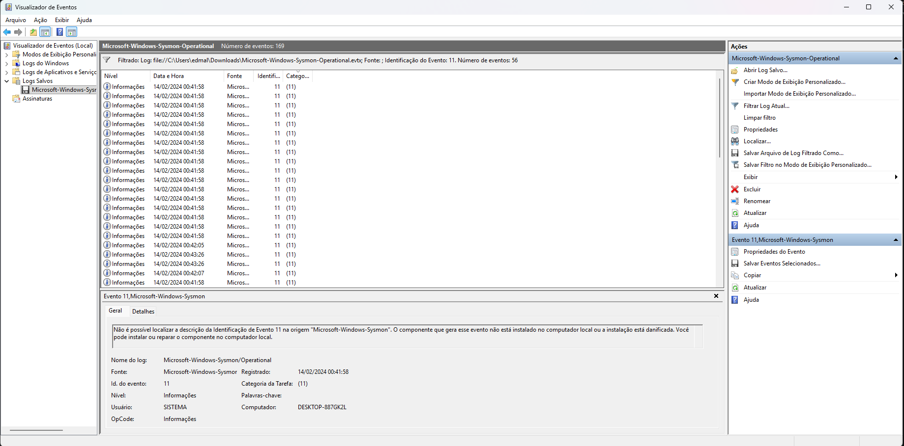
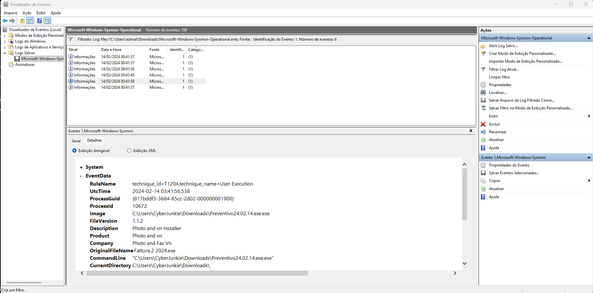
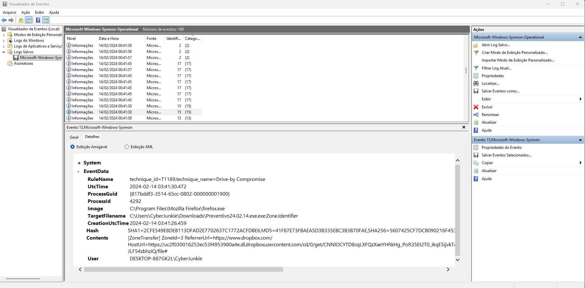
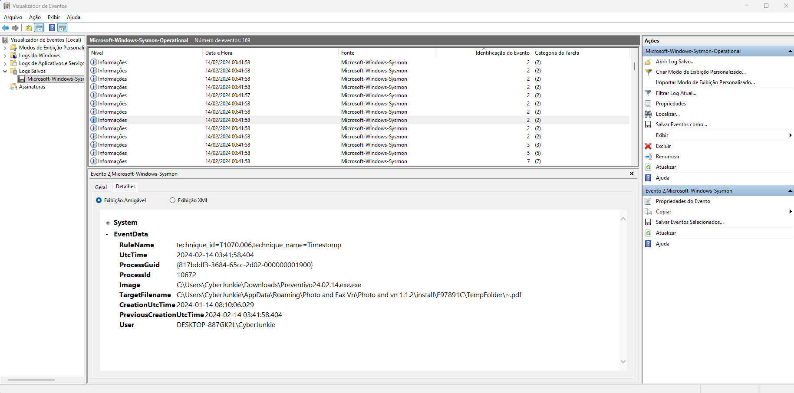
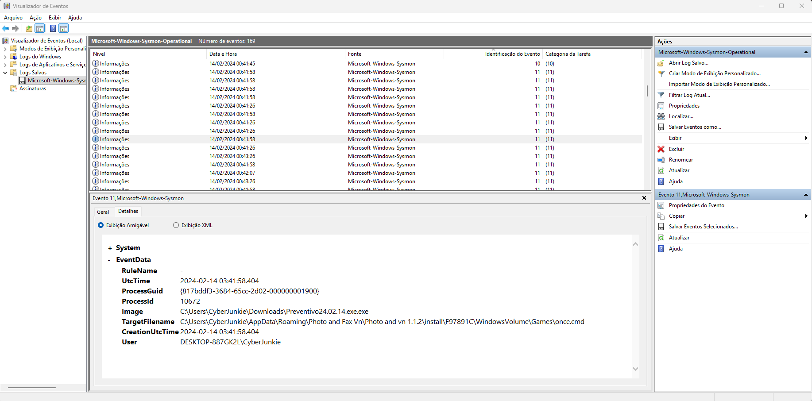
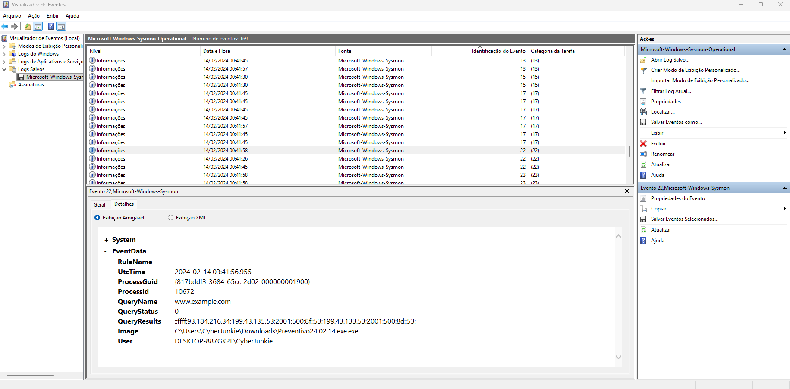
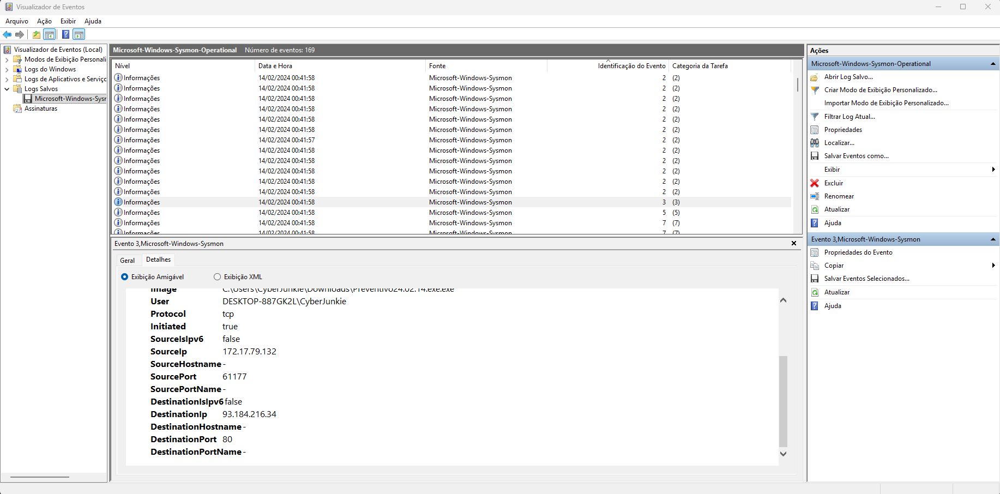
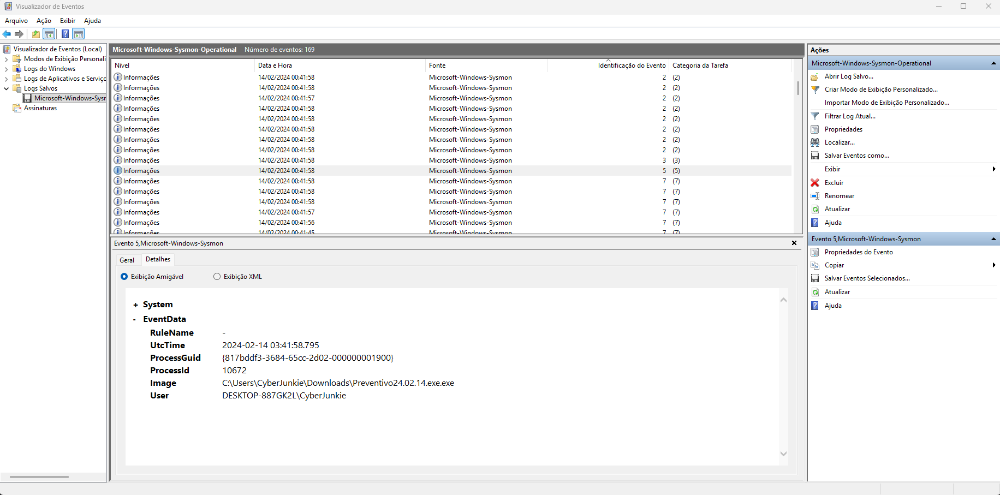

# Unit42

**Difficulty:** Very Easy

**Description:** Familiarization with Sysmon logs and relevant EventIDs for identifying and analyzing malicious activities on Windows systems. Based on a campaign investigated by Palo Alto Unit 42, involving a backdoored version of UltraVNC used by attackers to maintain access to compromised systems. The lab focuses on the initial access stage of the campaign.

### 1 - How many Event logs are there with Event ID 11?

I started filtering the event logs using Filter Current Log.

At the top of the window, the Event Viewer displays the total number of events matching the selected Event ID.



To answer the question, there are **56 events** with Event ID **11**.

### 2 - Whenever a process is created in memory, an event with Event ID 1 is recorded with details such as command line, hashes, process path, parent process path, etc. This information is very useful for an analyst because it allows us to see all programs executed on a system, which means we can spot any malicious processes being executed. What is the malicious process that infected the victim's system?

I filtered the event logs again using Filter Current Log.

I found **6 events** with Event ID **1**.



After analyzing the events chronologically, I identified a suspicious process that had been executed by the user.

Answer:

```bash
C:\Users\CyberJunkie\Downloads\Preventivo24.02.14.exe.exe
```

### 3 - Which Cloud drive was used to distribute the malware?

I searched through the events and found an interesting Event ID 15.

After analyzing the two events with this ID, I identified a `Zone.Identifier` associated with the downloaded file.

The file was downloaded from Dropbox.



Answer:

```
Dropbox
```

### 4 - For many of the files it wrote to disk, the initial malicious file used a defense evasion technique called Time Stomping, where the file creation date is changed to make it appear older and blend in with other files. What was the timestamp changed to for the PDF file?

I noticed that the events with ID 2 were associated with the **Time Stomping** technique.

After analyzing these events, I identified the PDF file whose timestamps had been modified.



The event shows that the PreviousCreationUtcTime was 2024-02-14 03:41:58.404, while the current CreationUtcTime is 2024-01-14 08:10:06.029.

Answer:

```
2024-01-14 08:10:06
```

### 5 - The malicious file dropped a few files on disk. Where was "once.cmd" created on disk? Please answer with the full path along with the filename.

I analyzed the events with ID 11, which represents file creation.

Since the question asks for a specific file, I identified it by analyzing the events.



answer:

```
C:\Users\CyberJunkie\AppData\Roaming\Photo and Fax Vn\Photo and vn 1.1.2\install\F97891C\WindowsVolume\Games\once.cmd
```

### 6 - The malicious file attempted to reach a dummy domain, most likely to check the internet connection status. What domain name did it try to connect to?

I analyzed the events with ID **22**, which represents DNS queries.

Before accessing Dropbox, the user queried the `www.example.com` domain, possibly to check whether the internet connection was working.



answer:

```
www.example.com
```

### 7 - Which IP address did the malicious process try to reach out to?

I analyzed the only event with ID **3**, which represents a network connection.

It shows that the source IP address `172.17.79.132` attempted to connect to the destination IP address `93.184.216.34`.



answer:

```
93.184.216.34
```

### 8 - The malicious process terminated itself after infecting the PC with a backdoored variant of UltraVNC. When did the process terminate itself?

I analyzed the only event with ID **5**, which represents process termination.

It shows the exact time when the process was terminated.



The process was terminated on **2024-02-14** at **03:41:58**.

answer:

```
2024-02-14 03:41:58
```

### Key Takeaway

This Sherlock demonstrated the importance of understanding Sysmon Event IDs when investigating security incidents. Knowing what each Event ID represents makes it easier to identify suspicious activities, correlate events, reconstruct process execution, and understand the sequence of actions performed on a compromised system.
